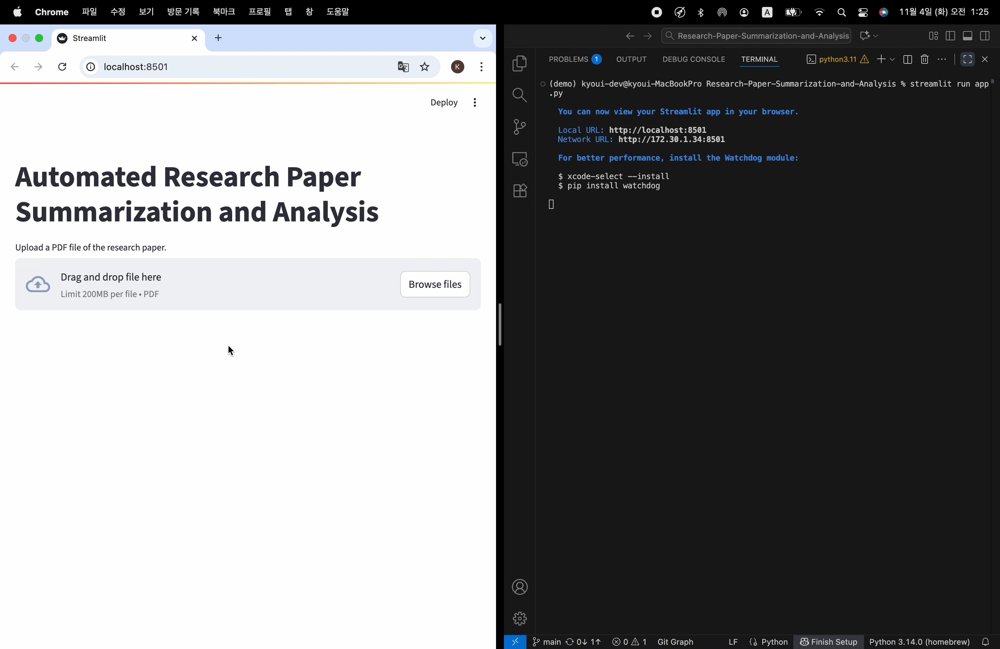
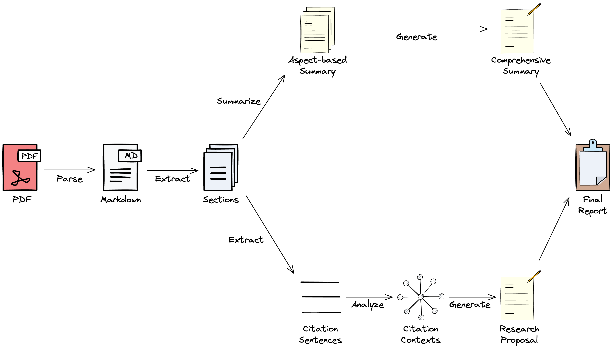
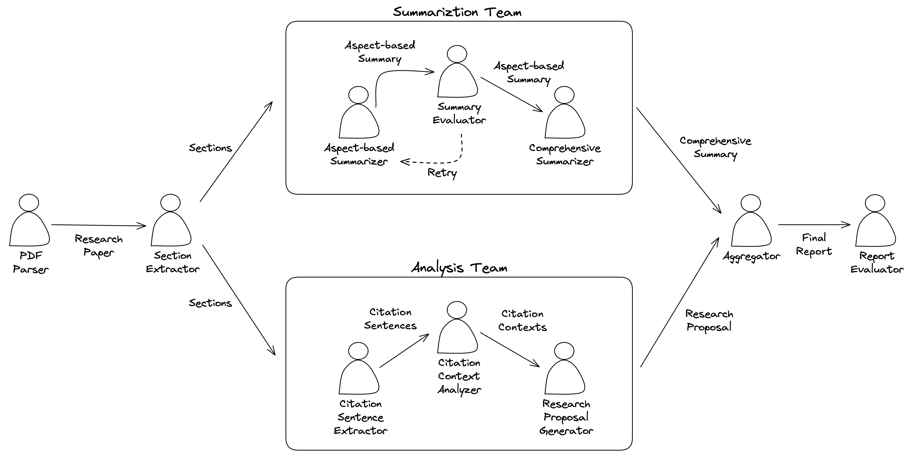

# Research Paper Summarization and Analysis



## Overview

This project implements an LLM workflow for **research paper summarization and analysis** using LangGraph.



## Setup

### Prerequisites

- Python 3.11
- Llama Cloud API Key
- OpenAI API Key

### Installation

```
pip install -r requirements.txt
```

### Environment Variables

Copy the `.env.example` file to `.env` and fill in your API keys.

```
cp .env.example .env
```

## Usage

### Launch demo

```
streamlit run app.py
```

### Run test

```
python test.py
```

## Workflow



- Prompt chaining: decomposes task into sequential steps
- Two LLM teams: summarization and analysis
- LLM-as-a-Judge: evaluates aspect-based summary and final report

## Evaluation

- Scores report using LLM-as-a-Judge
- Metrics: coherence, consistency, fluency, relevance, novelty (1–5 scale)
- Includes 3 test cases and 1 edge case:
    - Test case 1: *Attention Is All You Need*
    - Test case 2: *Fi-GNN: Modeling Feature Interactions via Graph Neural Networks for CTR Prediction*
    - Test case 3: *G-Eval: NLG Evaluation using GPT-4 with Better Human Alignment*
    - Edge case: *Highly accurate protein structure prediction with AlphaFold* (Biology + ML)

## Files

- `graph.py`: Graph definition
- `nodes.py`: Node definitions
- `prompts.py`: Prompt templates
- `schemas.py`: Structured output schemas
- `state.py`: State definition
- `app.py`: Streamlit demo
- `config.py`: Config loader
- `test.py`: Test script
